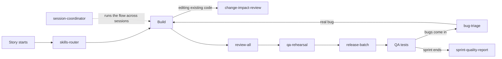

# delivery-skills

[](https://github.com/YousefEssawy/delivery-skills/releases)
[](LICENSE)

**Skills that help a coding agent finish a story the way QA expects it**: plan the checks before building, review the
real diff, test every acceptance criterion like QA before handing over, release in safe batches, and sort the bugs that
still arrive. They were built and refined on a real product team's sprints.

Works with Claude Code, Codex, Cursor, OpenCode and every agent the [Skills CLI](https://github.com/vercel-labs/skills)
supports.

**Contents:** [Install](#install) · [How they fit together](#how-they-fit-together) · [Delivery workflow](#delivery-workflow) ·
[Review and planning](#review-and-planning) · [Backend](#backend-net) · [Frontend](#frontend) ·
[Communication](#communication) · [Updating](#updating) · [Contributing](#contributing)

---

## Install

```bash
# See what is inside
npx skills add YousefEssawy/delivery-skills --list

# Install everything, for every project on this machine
npx skills add YousefEssawy/delivery-skills --global

# Install one skill
npx skills add YousefEssawy/delivery-skills --skill qa-rehearsal --global

# Install for one agent only
npx skills add YousefEssawy/delivery-skills --skill '*' --agent claude-code --global
```

**On claude.ai** a skill can follow your account to every device: zip one skill folder (the folder with its `SKILL.md`)
and upload it from *Customize › Skills › Add › Upload skill*.

Once installed, the agent picks a skill up on its own when your request matches it. You can also name it: "use
qa-rehearsal on PROJ-123".

---

## How they fit together



| Stage | Skill | One-line job |
|---|---|---|
| Plan | `skills-router` | Pick the checks for this task and map every acceptance criterion to a test. |
| Build | `change-impact-review`, the backend and frontend guards | Change code without breaking what already works. |
| Review | `review-all`, `git-commit` | Review the real diff with the right guards; commit with a clean message. |
| Before QA | `qa-rehearsal` | Try every criterion live, the way QA will. |
| Release | `release-batch` | One gate, one review, backend before its clients, a live smoke. |
| After QA | `bug-triage` | Real bug, not a bug, or a product question. |
| Look back | `sprint-quality-report` | Compare two sprints and decide what to change. |
| Run it all | `session-coordinator` | Split the work across sessions and accounts, and recover from crashes. |

---

## Delivery workflow

### `qa-rehearsal`
Tests a finished story the way QA will. It reads each acceptance criterion literally, splits it into small claims
(every "or", every limit, every error key) and tries each one live on the test environment, including the edge cases QA
always tries: Arabic letter forms, a word typed from the middle, boundaries, paging, account states, two requests at once,
and the UI in a real browser in both directions and themes.

> **Try:** "Run a QA rehearsal on PROJ-123 before I move it to Ready To Test."
>
> **You get:** a table per story with every claim marked PASS, FAIL (with the smallest fix), NOT PRODUCIBLE (with the
> test that covers it) or AMBIGUOUS (with the question for the product owner), and correlation ids as evidence.
> Example claim: *"Search finds a listing by a word typed from the middle of its title" → `q=يوتا` → 10 results → PASS.*

### `bug-triage`
Judges new QA bugs before anyone fixes them. It reads the bug, its story and every comment, the product decisions and
the code, reproduces the bug, and gives each one a verdict.

> **Try:** "Check the new bugs assigned to me and tell me which are real."
>
> **You get:** one table of bug, verdict and the reason (with the decision that settles it), a draft reply for each
> "not a bug" that mentions the reporter (shown to you before posting), and a test-first fix for each real bug.
> Example: *"Listings can't be created in Egypt" → not a bug: the launch scope allows Saudi Arabia only (with its key).*

### `release-batch`
Releases several finished branches together, safely. It merges them into one batch branch, stops if a migration changes
existing data, runs the full test gate once on a cleared machine, runs one independent review, opens the PRs with the
totals, promotes the backend before any client that depends on it, and checks every change live after deploy.

> **Try:** "These four branches are ready. Release them to testing."
>
> **You get:** the batch branch, the gate's summary table, the review result, the PRs, a smoke file with a correlation id
> per changed endpoint, and draft evidence comments for each story still in testing.

### `session-coordinator`
Runs a sprint across several agent sessions and accounts. It writes a brief file per task, names each session, keeps one
heavy test run at a time with lock files and a free-memory floor, brings the work back after a crash or a power cut, and
keeps a handoff file another machine can continue from.

> **Try:** "Split these fixes across sessions on my second account and keep me posted."
>
> **You get:** brief files your sessions can start from with one line, a status table of what runs where, and only the
> decisions and evidence that need you.

### `sprint-quality-report`
Compares two sprints from the live board, per team: stories, bugs raised, real bugs against "not a bug", stories that
passed QA first time, and where the bugs cluster. Then gives an assessment with grades and next-sprint actions, as a
dashboard.

> **Try:** "Compare Sprint 1 and Sprint 2 quality for backend, web and mobile."
>
> **You get:** a dashboard with a report card per team, a before-and-after table, charts and an assessment, plus the raw
> counts and how they were counted.

---

## Review and planning

### `skills-router`
Runs at the start of a story or bug and decides which skills apply, before any code is written. It changes no code.

> **Try:** "Start PROJ-124."
>
> **You get:** the skills to use while building and before committing, and every acceptance criterion mapped to a named test.

### `change-impact-review`
A before-and-after check for any edit, rename, delete or refactor. It searches the whole codebase first, checks every
layer (database, backend, frontend, emails, PDFs, translations, docs), confirms the source of truth, then reports back.

> **Try:** "Rename the event date field everywhere."
>
> **You get:** every place the field appears, including copies hard-coded in emails or templates, changed together, with a
> final search proving nothing was missed.

### `review-all`
A full review of the work just done: it reads the actual diff, picks the review skills that fit each kind of change, runs
them and merges the findings into one list.

> **Try:** "Review all before I commit."
>
> **You get:** one list of findings by severity, the skills that ran, and any that would have applied but are not installed.

### `git-commit`
Writes a Conventional Commits message from the real diff (feat, fix, refactor...), proposes a split when the changes are
unrelated, and commits only after you approve. It never pushes.

> **Try:** "Commit this."
>
> **You get:** a ready message such as `fix(search): match a word typed from the middle of a stored word`, waiting for your yes.

---

## Backend (.NET)

### `controller-guide`
Audits, writes or reviews ASP.NET Core Web API controllers against a bundled style guide (routes, binding sources,
responses, layering). The rules come from the skill itself, not from the project.

> **Try:** "Audit my controllers."
>
> **You get:** a report per controller with each rule it breaks and the fix; or a new controller written to the guide.

### `dotnet-backend-validation`
Adds FluentValidation validators with the auto-validation pattern, or scans the backend for request models that have no
validation. *Written in Egyptian Arabic.*

> **Try:** "Which requests have no validation?" or "Add a validator for CreateOrderRequest."
>
> **You get:** the list of unvalidated requests, or a validator wired into the project's existing pattern.

### `dotnet-backend-testing`
Writes NUnit unit tests (constraint model and Moq), or scans for services, methods and validators with no tests.
*Written in Egyptian Arabic.*

> **Try:** "Write tests for OrderService" or "What is missing test coverage?"
>
> **You get:** tests named `Method_Scenario_Expected` in Arrange / Act / Assert form, or a coverage gap list.

### `date-kind-guard`
Classifies a date or time field (calendar date, instant or wall-clock) and wires its storage, API, display and filters to
match, so a value never shifts by a day for users in another time zone.

> **Try:** "Add a check-in date to bookings."
>
> **You get:** the field's kind and the right handling on every layer, with the classic off-by-one-day traps avoided.

---

## Frontend

### `frontend-form-validation`
Audits every form in an Angular or React app: which inputs are required, which validation each one has, what it is
missing, and where the frontend and a .NET backend disagree. Reports first, applies fixes after your approval.
*Written in Egyptian Arabic.*

> **Try:** "Audit the forms against the backend validation."
>
> **You get:** a report ranked by severity, flagging fields checked only in the browser (a security gap), then the fixes in
> the project's own style.

### `ui-responsive-audit`
Opens the UI in a real browser across phone, tablet and desktop sizes (short heights too), right-to-left and left-to-right,
light and dark, and checks in code that nothing overflows or breaks.

> **Try:** "Check the new dialog is responsive and works in Arabic."
>
> **You get:** a pass or fail per size, direction and theme, with the element that overflows and a screenshot.

### `i18n-locale-sync`
Adds every new user-facing text to all locale files at once, checks that every locale has the same keys, and finds strings
hard-coded outside i18n.

> **Try:** "Add the labels for the new screen in English and Arabic."
>
> **You get:** the keys in every locale file, and a list of any missing keys or hard-coded strings.

### `clone-feature`
Builds a new feature by copying the full file and wiring chain of an existing one in the same project: every layer and
every place it plugs in (routes, navigation, translations, dependency injection).

> **Try:** "Add Invoices the same way Orders is built."
>
> **You get:** the new feature on every layer, with a checklist proving each wiring point was done.

---

## Communication

### `arabic-tech-explainer`
Explains English technical material in Egyptian Arabic while keeping the English terms, numbers and code as they are,
rendered as a right-to-left widget so the mixed text never scrambles.

> **Try:** "اشرح ده بالعربي" with a technical paragraph pasted.
>
> **You get:** a clean right-to-left explanation where every English term stays readable.

---

## Works well with

[amElnagdy/guard-skills](https://github.com/amElnagdy/guard-skills) (`clean-code-guard`, `test-guard`, `docs-guard`).
`review-all` and `release-batch` use them when they are installed.

## Updating

Skills install as a copy, so a new version reaches your agent only when you update:

```bash
npx skills update                 # every installed skill
npx skills update qa-rehearsal    # one skill
```

Re-running `npx skills add YousefEssawy/delivery-skills` also fetches the latest. Every change is listed in
[CHANGELOG.md](CHANGELOG.md), and releases are tagged `vMAJOR.MINOR.PATCH`.

## Contributing

- One folder per skill under `skills/`, with a `SKILL.md` whose front matter has `name` and `description`.
- Keep project names, people, hosts and credentials out of every skill.
- Bump the version and add a CHANGELOG entry with every change.

## License

[MIT](LICENSE)
